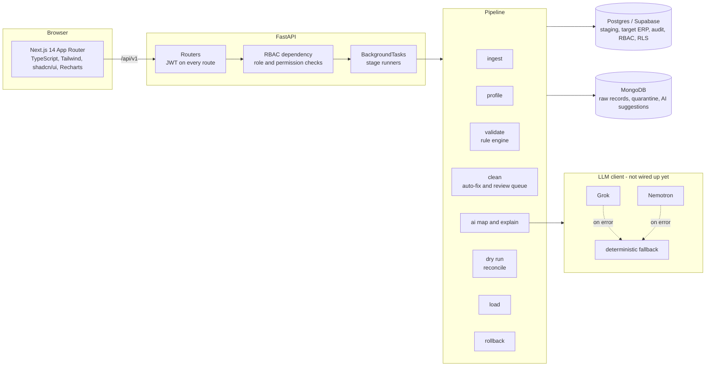
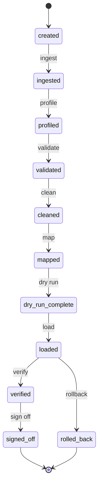

# CleanSlate

Move the data, not the mistakes.

CleanSlate moves years of legacy ERP data into a clean target schema and leaves
the legacy errors behind. You upload the source extracts, and the pipeline
profiles, validates, cleans, maps, dry-runs, loads, verifies and signs off each
batch. Every stage is auditable and every batch can be rolled back.

## What it does

The pipeline runs in stages. Each stage writes a status row and an audit entry.

1. Ingest. Read CSV, Excel and SQL dumps per entity. Keep the raw copy in Mongo.
2. Profile. Per column: null rate, distinct count, inferred type, format
   patterns, outliers and date ranges.
3. Validate. Run the rule engine over the data and record each finding with a
   severity, a message and a suggested fix.
4. Clean. Fix the safe problems automatically and queue the rest for a human.
5. Map. Legacy-to-target column mapping. The stage is declared and shows in the
   wizard, but the LLM that would fill it is not wired up yet. See Status below.
6. Dry run. Load into a sandbox schema and reconcile. Counts and financial
   totals must match before the load is allowed.
7. Load. Write to the target ERP tables in dependency order, transactionally
   and idempotently, per batch.
8. Verify. Reconcile after the load, score the result, and produce a sign-off
   report.
9. Roll back. Revert any batch. Every row carries a batch id and a source
   reference.

## Architecture



The frontend calls the API on the same origin. Next.js rewrites `/api/*` to the
FastAPI service, so the browser never makes a cross-origin call.

## Pipeline flow



## Security

Access control is enforced in the database, not only in the API.

- Roles: Admin, Migration Engineer, Finance Controller, Inventory Manager and
  Supplier.
- Supabase Auth issues a JWT. Every route verifies it.
- Row Level Security policies restrict each table per role. The API also
  connects as a non-superuser role, so a policy that is missing fails closed.
- A supplier sees its own purchase orders and catalogue, and nothing else.
- Salary and tax id columns are encrypted at rest and masked in the interface
  by role.
- The audit log is append-only. Triggers refuse updates and deletes. The
  interface proves this by attempting both and reporting the refusal.

## Layout

```
backend/
  app/api/routers/     REST routers, one per area
  app/pipeline/        stage implementations and the demo data generator
  app/rules/           rule engine; rules live in config/rules.json
  db/migrations/       SQL migrations, applied by app/db/migrate.py
  tests/               pytest suite, runs against real Postgres and Mongo
frontend/
  src/app/             App Router pages
  src/components/      shared components and shadcn/ui primitives
  src/lib/             API client, hooks, session, types
scripts/               database startup, demo data, seed
docs/                  diagrams and the demo script
```

## Setup

Five commands, from a clean checkout.

```bash
cp .env.example .env
make setup        # venv, dependencies, databases, migrations
make demo-data    # write the synthetic legacy dataset to data/legacy
make seed         # seed the demo users and run a full migration
make api          # FastAPI on :8000
```

Run the frontend in a second shell.

```bash
cd frontend && npm install && npm run build && npm start
```

The interface is on port 3000. Set `PORT` to serve a different one.

## Demo accounts

The seed creates one account per role. The password is `cleanslate` for all of
them.

| Email | Role |
| --- | --- |
| admin@cleanslate.test | Admin |
| engineer@cleanslate.test | Migration Engineer |
| finance@cleanslate.test | Finance Controller |
| inventory@cleanslate.test | Inventory Manager |
| supplier@cleanslate.test | Supplier |

Sign in as the supplier to see the finance dashboard disappear.

## Demo data

`scripts/generate_demo_data.py` builds an N-year legacy dataset of about 50,000
records with labelled defects: duplicates, orphans, bad tax ids, unbalanced
ledgers, dead vendors, mixed units of measure and impossible dates. It writes
`defects_manifest.csv`, and the detection harness scores the rule engine
against it.

Current result on the full dataset: 100% recall, 99.81% precision (6,279
injected defects, all 6,279 caught).

## API

OpenAPI documentation is served at `/docs`. Routes are under `/api/v1`.

| Area | Routes |
| --- | --- |
| Auth | `POST /auth/login`, `GET /auth/me`, `POST /auth/logout` |
| Batches | `GET|POST /batches`, `GET|DELETE /batches/{id}` |
| Stages | `POST /batches/{id}/{ingest,profile,validate,clean,dry-run,load,rollback}` |
| Reports | `GET /batches/{id}/{summary,reconciliation,health}` |
| Findings | `GET /findings`, `GET /findings/summary`, `GET /findings/rules` |
| Review | `GET /review`, `POST /review/{id}/{approve,reject}`, `POST /review/bulk` |
| Audit | `GET /audit`, `GET /audit/verify/immutability` |
| Security | `GET /security/rls-matrix`, `GET /security/rls-matrix/{table}` |
| Supplier | `GET /supplier/portal`, `/purchase-orders`, `/catalogue` |
| Inventory | `GET /inventory/insights` |
| Export | `GET /reports/{id}/report.pdf`, `findings.csv`, `reconciliation.csv`, `audit.csv` |

## Tests

```bash
make test        # full suite, 126 tests
make test-fast   # everything except the slow pipeline tests
```

Tests run against real Postgres and Mongo, not mocks. Start the databases with
`make db-up` first.

## Configuration

All settings have working defaults for local development. See `.env.example`.
You do not need any keys to run the platform. The `LLM_*`, `GROK_*` and
`NEMOTRON_*` settings are read but not yet used, because the LLM client is not
implemented. See Status below.

## Status

Built and working: schema, RBAC, RLS, ingest, profile, validate, clean, review
queue, dry run, load, rollback, reconciliation, audit log, reports, the
dashboards and the demo data generator. The test suite covers these.

Not built yet:

- The LLM client. There is no `LLMClient`, no call to Grok or Nemotron, and no
  deterministic fallback. The `map` stage is declared and appears in the wizard,
  but nothing runs it, so it stays pending. No AI mapping or plain-English
  explanation is produced, and `review_queue.ai_suggestion` is empty.
- The verify and sign-off stages. Reconciliation and the health score are
  computed by the load stage and shown on the dashboards, but there is no
  separate verify endpoint or go-live checklist.
- Postman collection, the architecture and flow diagrams as separate files, and
  the three-minute demo script. The diagrams in this README are the current
  source.

## Notes

The health score is reported twice: on arrival and after cleaning. The arrival
score is set once and does not move when a batch is re-validated. The after
score is written by the clean stage. Readers report the after score and fall
back to the arrival score before cleaning has run.
